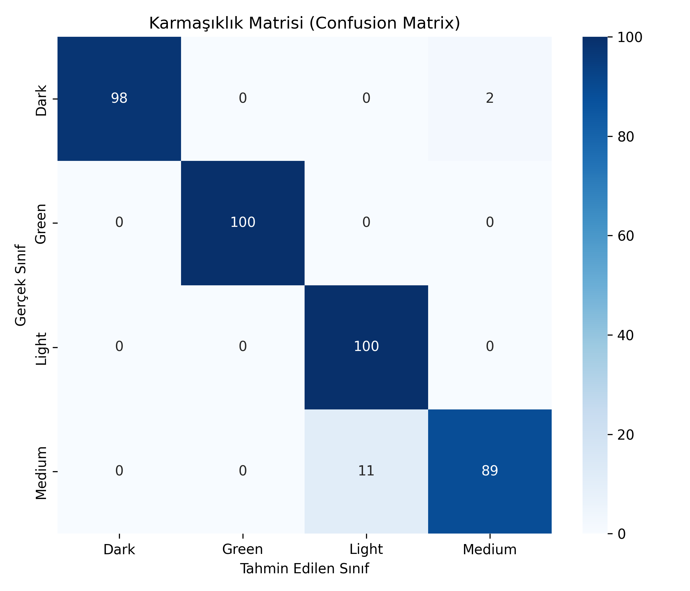
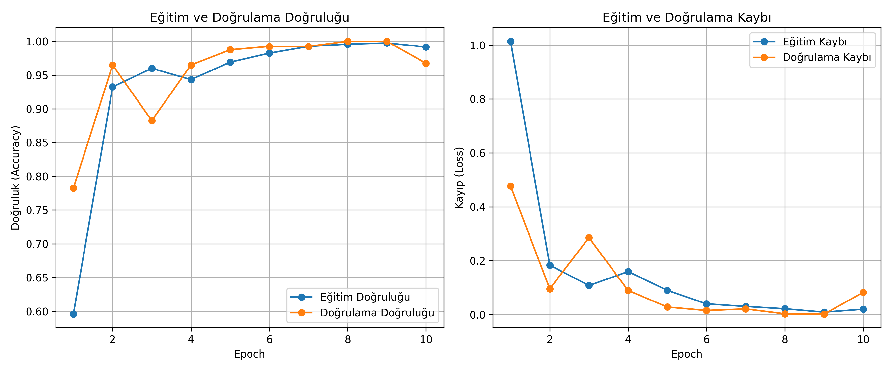

# Evrişimli Sinir Ağları (CNN) ile Kahve Çekirdeği Kavurma Seviyelerinin Çok Sınıflı Sınıflandırılması

Bu proje, **İstanbul Arel Üniversitesi Mühendislik Fakültesi LBLM368 - Derin Öğrenme ve Sınıflandırma Teknikleri** dersi dönem projesi kapsamında geliştirilmiştir.

- **Öğrenci Adı Soyadı:** Ruken YILDIZ  
- **Öğrenci Numarası:** 230309047  

---

## 📌 Projenin Amacı ve Özeti
Bu çalışmada, kahve çekirdeği fotoğraflarını kullanarak çekirdeklerin kavrulma derecelerini (**Green**, **Light**, **Medium** ve **Dark**) derin öğrenme tabanlı bir Evrişimli Sinir Ağı (CNN) ile otomatik olarak sınıflandırmak amaçlanmıştır. Endüstriyel kahve kavurma ve paketleme tesislerinde insan gözlemine dayalı kalite kontrol hatalarını ortadan kaldırarak standardizasyon sağlamaktadır.

---

## 📊 Veri Seti
- **Veri Seti:** [Coffee Bean Dataset Resized (224x224)](https://www.kaggle.com/datasets/gpiosenka/coffee-bean-dataset-resized-224-x-224)
- **Toplam Görsel:** 2000 adet (1200 Train, 400 Validation, 400 Test)
- **Sınıflar (4 Sınıf):**
  1. `Dark` (Koyu Kavrulmuş)
  2. `Green` (Kavrulmamış / Ham Çekirdek)
  3. `Light` (Açık Kavrulmuş)
  4. `Medium` (Orta Kavrulmuş)
- **Çözünürlük:** 224x224 RGB

---

## 🧠 Model Mimarisi (CNN)
```
Input (224x224x3)
  │
Rescaling (1./255)
  │
Conv2D (32 filtre, 3x3, ReLU) ──> MaxPooling2D (2x2)
  │
Conv2D (64 filtre, 3x3, ReLU) ──> MaxPooling2D (2x2)
  │
Conv2D (128 filtre, 3x3, ReLU) ──> MaxPooling2D (2x2)
  │
Flatten
  │
Dense (128, ReLU)
  │
Dropout (0.3)
  │
Dense (4, Softmax)
```

- **Optimizasyon:** Adam (Learning Rate = 0.001)
- **Kayıp Fonksiyonu:** Sparse Categorical Crossentropy
- **Epoch:** 10 | **Batch Size:** 32

---

## 📈 Sonuçlar ve Metrikler

### Test Kümesi Performansı (400 Test Görseli)
- **Test Doğruluğu (Accuracy):** `%96.75`
- **Kesinlik (Precision - Macro Avg):** `0.9697` (%96.97)
- **Duyarlılık (Recall - Macro Avg):** `0.9675` (%96.75)
- **F1-Skoru (Macro Avg):** `0.9674` (%96.74)

### Karmaşıklık Matrisi (Confusion Matrix)


### Doğruluk ve Kayıp Grafikleri


---

## 🚀 Kurulum ve Çalıştırma

### 1. Gereksinimleri Yükleyin:
```bash
pip install -r requirements.txt
```

### 2. Modeli Eğitin ve Test Edin:
```bash
python train.py
```
*(Veri seti `kagglehub` üzerinden otomatik olarak indirilecek ve eğitim başlayacaktır).*
