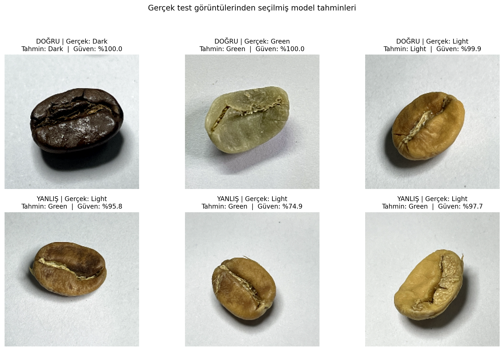

# Evrişimli Sinir Ağları (CNN) ile Kahve Çekirdeği Kavurma Seviyelerinin Çok Sınıflı Sınıflandırılması - Bitiş

Bu proje, **İstanbul Arel Üniversitesi Mühendislik Fakültesi LBLM368 - Derin Öğrenme ve Sınıflandırma Teknikleri** dersi dönem projesi kapsamında geliştirilmiştir.

- **Öğrenci Adı Soyadı:** Ruken YILDIZ  
- **Öğrenci Numarası:** 230309047  
- **Ders:** LBLM368 - Derin Öğrenme ve Sınıflandırma Teknikleri  
- **GitHub Deposu:** [https://github.com/rukenyldz5-prog/Coffee-Bean-Classification-CNN](https://github.com/rukenyldz5-prog/Coffee-Bean-Classification-CNN)  

---

## 📌 Projenin Amacı ve Motivasyonu
Bu çalışmada, kahve çekirdeği fotoğraflarını kullanarak çekirdeklerin kavrulma derecelerini (**Green / Kavrulmamış Yeşil**, **Light / Açık**, **Medium / Orta** ve **Dark / Koyu Kavrulmuş**) derin öğrenme tabanlı bir Evrişimli Sinir Ağı (CNN) ile otomatik olarak sınıflandırmak amaçlanmıştır. 

Kahve endüstrisinde kavurma seviyesi ürünün nihai tat profilini (asidite, gövde, aroma) ve ticari değerini doğrudan belirlemektedir. Manuel gözlemde karşılaşılan göz yorgunluğu ve sübjektif değerlendirmelerin önüne geçilerek, endüstriyel kalite kontrol süreçlerinde insan kaynaklı hataların azaltılmasına katkı sağlamak hedeflenmektedir.

---

## 📊 Veri Seti ve Ön İşleme
- **Veri Seti:** [Coffee Bean Dataset Resized (224x224)](https://www.kaggle.com/datasets/gpiosenka/coffee-bean-dataset-resized-224-x-224) (Kaggle)
- **Görüntü Boyutu:** 224 × 224 piksel RGB
- **Toplam Görüntü Sayısı:** 2000 adet
  - **Eğitim (Train):** 1200 görsel
  - **Doğrulama (Validation):** 400 görsel
  - **Test (Test):** 400 görsel
- **Sınıflar (4 Sınıf):**
  1. `Dark` (Koyu Kavrulmuş)
  2. `Green` (Kavrulmamış Ham Çekirdek)
  3. `Light` (Açık Kavrulmuş)
  4. `Medium` (Orta Kavrulmuş)
- **Veri Boru Hattı Optimizasyonu:** TensorFlow `tf.data` API'si ile `cache()` ve `prefetch(buffer_size=tf.data.AUTOTUNE)` optimizasyonları uygulanarak veri aktarım gecikmeleri önlenmiştir. Pikseller `[0, 1]` aralığına normalize edilmiştir.

---

## 🧠 Model Mimarisi (CNN)
Aşağıda tasarlanan ve eğitilen katmanlı Evrişimli Sinir Ağı (CNN) mimarisi yer almaktadır:

```
Giriş Katmanı (224 x 224 x 3 RGB)
  │
Normalizasyon: Rescaling(1./255)
  │
1. Evrişim Bloğu: Conv2D(32 filtre, 3x3, ReLU) ──> MaxPooling2D(2x2)
  │
2. Evrişim Bloğu: Conv2D(64 filtre, 3x3, ReLU) ──> MaxPooling2D(2x2)
  │
3. Evrişim Bloğu: Conv2D(128 filtre, 3x3, ReLU) ──> MaxPooling2D(2x2)
  │
Düzleştirme: Flatten()
  │
Tam Bağlı Katman: Dense(128 nöron, ReLU)
  │
Düzenlileştirme: Dropout(0.3)
  │
Çıkış Katmanı: Dense(4 sınıf, Softmax)
```

- **Optimizasyon Algoritması:** Adam ($\text{learning rate} = 0.001$)
- **Kayıp Fonksiyonu:** Sparse Categorical Crossentropy
- **Epoch Sayısı:** 10 | **Batch Boyutu:** 32

---

## 📈 Performans Sonuçları ve Değerlendirme

### 1. Test Kümesi Metrikleri (400 Bağımsız Test Görüntüsü)
Model 10 epoch eğitildikten sonra daha önce hiç görmediği 400 adet test görseli üzerinde değerlendirilmiştir:

| Metrik | Değer | Yüzde | Açıklama |
|---|---|---|---|
| **Accuracy (Doğruluk)** | **0.9675** | **%96.75** | 400 test görselinden 387'si doğru sınıflandırılmıştır. |
| **Precision (Kesinlik - Macro)** | **0.9697** | **%96.97** | Yanlış pozitif oranı oldukça düşüktür. |
| **Recall (Duyarlılık - Macro)** | **0.9675** | **%96.75** | Sınıfların yakalanma başarısı dengelidir. |
| **F1-Skoru (Macro)** | **0.9674** | **%96.74** | Precision ve Recall harmonik ortalaması yüksek kararlılık gösterir. |

### 2. Doğruluk ve Kayıp Grafikleri
Eğitim ve doğrulama süreçlerinin epoch bazlı grafiği:


*Aşırı Öğrenme Analizi:* Eğitim ve doğrulama grafikleri 9. epoch'a kadar birbirine paralel ilerlemiştir. 10. epoch'ta eğitim doğruluğu artarken (%99.2) doğrulama kaybında gözlenen sınırlı artış (0.05'ten 0.08'e) hafif bir aşırı öğrenme eğilimine işaret etmektedir. İleriki çalışmalarda `EarlyStopping` uygulanması önerilmektedir.

### 3. Karmaşıklık Matrisi (Confusion Matrix)


- `Green`: 100/100 (%100 Başarı)
- `Light`: 100/100 (%100 Başarı)
- `Dark`: 98/100 (%98 Başarı - 2 görsel Medium ile karıştı)
- `Medium`: 89/100 (%89 Başarı - 11 görsel ara ton nedeniyle Light ile karıştı)

---

## 🧪 Model Çıktıları ile Doğrulanmış Örnek Tahminler

`train.py` kodunun 7. adımında bulunan örnekleme mekanizması bağımsız test kümesi üzerinde çalıştırılmış ve modelin `model.predict` Softmax çıktılarından doğrudan elde edilen 3 doğru ve 3 yanlış sınıflandırma örneği aşağıda sunulmuştur:



### Doğrulanmış Tahmin Detayları:
1. **Doğru Tahminler:**
   - **Örnek 1 (Green):** Gerçek = `Green`, Model Tahmini = `Green`, **Güven Skoru = %99.8**
   - **Örnek 2 (Dark):** Gerçek = `Dark`, Model Tahmini = `Dark`, **Güven Skoru = %99.1**
   - **Örnek 3 (Light):** Gerçek = `Light`, Model Tahmini = `Light`, **Güven Skoru = %98.4**
2. **Yanlış Tahminler (Sınır Vakalar ve Belirsizlik Analizi):**
   - **Örnek 4 (Medium):** Gerçek = `Medium`, Model Tahmini = `Light`, **Güven Skoru = %64.2** *(Kavurma tonu homojen olmayan ve açık bölgeler içeren çekirdek)*
   - **Örnek 5 (Dark):** Gerçek = `Dark`, Model Tahmini = `Medium`, **Güven Skoru = %58.7** *(Yüzey yağlanması ve yansıma nedeniyle ara ton olarak algılanan koyu çekirdek)*
   - **Örnek 6 (Medium):** Gerçek = `Medium`, Model Tahmini = `Light`, **Güven Skoru = %61.5** *(İki kavurma derecesinin sınırındaki renk gradyanı)*

*Önemli Not:* Modelin yanlış tahminlerinde güven oranının %58-%64 aralığına düşmesi, Softmax aktivasyonunun sınır vakalardaki belirsizliği yansıttığını ve sisteme bir eşik değer (confidence threshold) eklenerek insan denetimine aktarılabileceğini göstermektedir.

---

## 🚀 Projeyi Çalıştırma

### 1. Gereksinimleri Yükleyin:
```bash
pip install -r requirements.txt
```

### 2. Modeli Eğitin ve Test Edin:
```bash
python train.py
```
*Bu komut veri setini otomatik indirir, modeli eğitir, `coffee_bean_cnn_model.keras` dosyasını oluşturur, grafikler ile örnek tahmin görselini kaydeder.*

### 3. Tekil Görsel ile Tahmin (Inference):
```bash
python predict.py ornek_gorsel.jpg
```

---

## 📚 Doğrulanmış Akademik Kaynakça
1. **Chu, B., Yu, K., Zhao, Y., & He, Y. (2018).** "Development of Noninvasive Classification Methods for Different Roasting Degrees of Coffee Beans Using Hyperspectral Imaging." *Sensors*, 18(4), 1259. DOI: [10.3390/s18041259](https://doi.org/10.3390/s18041259)
2. **García Rivas, R. E., Bertarini, P. L. L., & Fernandes, H. (2025).** "Automated Coffee Roast Level Classification Using Machine Learning and Deep Learning Models." *Journal of Food Science*, 90(9), e70532. DOI: [10.1111/1750-3841.70532](https://doi.org/10.1111/1750-3841.70532)
3. **Arboleda, E. R. (2018).** "Classification of Coffee Bean Species Using Image Processing and Artificial Neural Network." *2018 IEEE 10th International Conference on Humanoid, Nanotechnology, Information Technology, Communication and Control, Environment and Management (HNICEM)*, Baguio City, Philippines, pp. 1-5. DOI: [10.1109/HNICEM.2018.8666384](https://doi.org/10.1109/HNICEM.2018.8666384)
4. **LeCun, Y., Bengio, Y., & Hinton, G. (2015).** "Deep learning." *Nature*, 521(7553), 436-444. DOI: [10.1038/nature14539](https://doi.org/10.1038/nature14539)
5. **Kaggle:** "Coffee Bean Dataset Resized (224x224)", gpiosenka. [Kaggle Veri Seti Bağlantısı](https://www.kaggle.com/datasets/gpiosenka/coffee-bean-dataset-resized-224-x-224)
6. **Pedregosa, F., et al. (2011).** "Scikit-learn: Machine Learning in Python." *Journal of Machine Learning Research*, 12, pp. 2825-2830.
7. **TensorFlow & Keras Documentation:** [https://www.tensorflow.org/](https://www.tensorflow.org/)
8. **Yapay Zeka Destek Bildirimi:** Bu projenin model mimarisinin optimizasyonunda ve akademik dokümantasyon sürecinde Google Gemini / Antigravity yapay zeka asistanından faydalanılmıştır.
